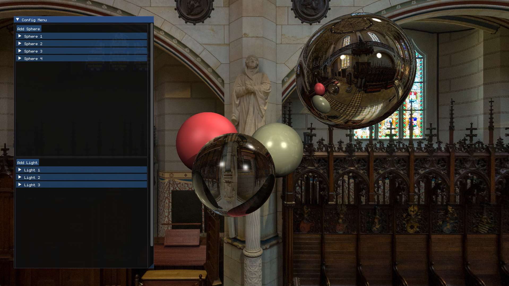

# Raytracing Engine with OpenGL, SDL3 and ImGUI

A CPU ray tracer written in C++ that renders reflections, refraction, shadows and an environment map, with a live config menu for adding and editing spheres and lights while the program is running!

Built on top of Dmitry Sokolov's [tinyraytracer](https://github.com/ssloy/tinyraytracer/wiki) tutorial, then extended with a BVH, multithreaded rendering and an interactive interface.



## Features

**Rendering**
- Diffuse and specular lighting from multiple point lights
- Shadows
- Reflections (mirror-like spheres)
- Refraction (glass-like spheres)
- Environment map background that is also reflected and refracted in the objects

**Beyond the tutorial**
- **BVH (bounding volume hierarchy):** objects are grouped into nested bounding boxes so rays can skip objects they cannot hit instead of testing every one.
- **CPU parallelisation with OpenMP:** each pixel is independent, so the image is split across cores with `#pragma omp parallel for`.
- **Live config menu (ImGui):** add spheres and lights, expand any object to edit its properties, and see the render update right away.

## Config menu

The menu lists every sphere and light in the scene.

- **Add Sphere / Add Light:** create a new object.
- **Expand an entry:** edit its properties
- Changes are applied immediately without restarting or recompiling.

## Tech stack

| Part | Used for |
|---|---|
| C++ 17 | Core renderer |
| OpenMP | Multithreaded rendering |
| OpenGL | Displaying the rendered image |
| SDL3 | Window and input |
| Dear ImGui | Config menu |

## Building and running

```bash
git clone https://github.com/BaguetteBunny/Configurable-Rendering-Engine
cd Configurable-Rendering-Engines
g++ -std=c++17 -O3 -march=native -mfma -ffast-math -fopenmp -Iinclude -Iimgui -Iimgui/backends -Iinclude/SDL3 main.cpp imgui/imgui.cpp imgui/imgui_draw.cpp imgui/imgui_tables.cpp imgui/imgui_widgets.cpp imgui/backends/imgui_impl_sdl3.cpp imgui/backends/imgui_impl_opengl3.cpp -Llib -lSDL3 -lmingw32 -lopengl32 -lgdi32 -o main.exe
./main.exe
```

Run the executable from the repository root, since the program loads `assets/fonts/monogram.ttf` and `assets/church_of_lutherstadt.jpg` using relative paths.

**Requirements**
- A C++ compiler with C++17 and OpenMP support (the build command above targets MinGW-w64 g++ on Windows)
- SDL3 headers in `include/SDL3` and the static library in `lib/`
- Dear ImGui sources in `imgui/`, including the SDL3 and OpenGL3 backends
- An OpenGL 3.3-capable GPU and driver

## Credits

- [tinyraytracer](https://github.com/ssloy/tinyraytracer/wiki) by Dmitry V. Sokolov for the tutorial this project is based on.
- [Dear ImGui](https://github.com/ocornut/imgui) for the interface.

## License

[MIT](LICENSE)